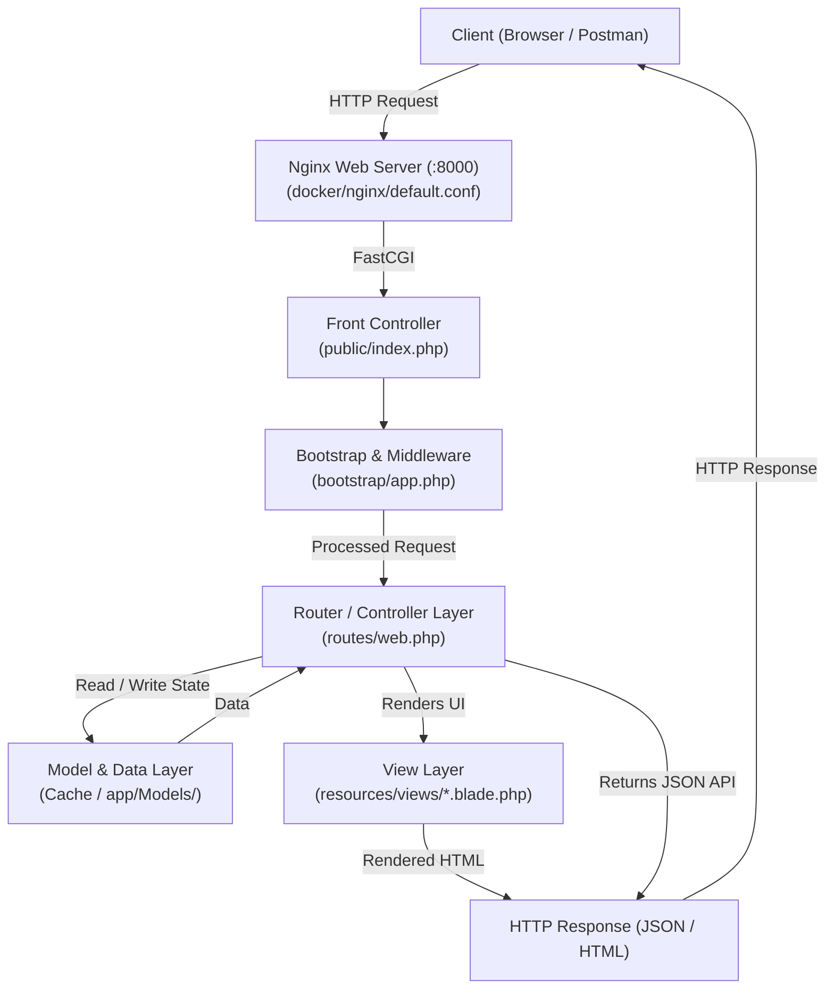
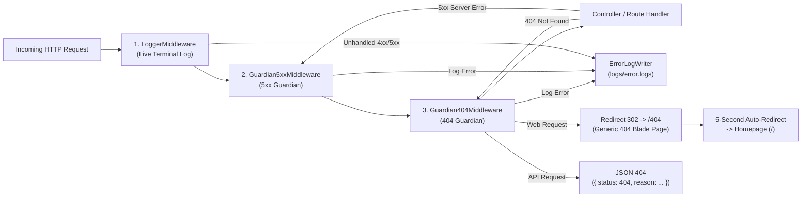

# Alumni Tracking & Community Networking System

A scalable, web-based alumni management and engagement platform designed to bridge the gap between educational institutions, organizations, students, and graduates. The system empowers communities to maintain lifelong connections, support professional growth, and foster collaborative networking.


## About the Project

Maintaining active connections with graduates is a significant challenge for many universities, academies, and professional institutions. The **Alumni Tracking System** serves as a centralized digital ecosystem where alumni can showcase their career achievements, engage with peers, mentor upcoming students, and share professional opportunities.

Built with modern web standards, this platform offers a secure, modular, and customizable foundation adaptable to any institution looking to modernize its alumni relations and career support networks.


## Technology Stack

| Layer | Technology | Purpose |
| :--- | :--- | :--- |
| **Backend Framework** | [Laravel (PHP 8.2+)](https://laravel.com/) | Robust MVC architecture, routing, security, and ORM |
| **Database** | [MySQL 8.0](https://www.mysql.com/) | Relational data persistence and optimized query performance |
| **Containerization** | [Docker](https://www.docker.com/) & Docker Compose | Consistent, reproducible development and production environments |
| **Web Server** | Nginx | High-performance reverse proxy and static asset handling |
| **API Documentation** | [Swagger / OpenAPI 3.0](https://swagger.io/) | Interactive API specification and live endpoint testing |
| **Frontend** | Blade & Modern CSS/JS | Responsive, accessible, and intuitive user interfaces |


## Core System Modules & Features

### 1. Comprehensive Profile & Portfolio Management
- **Professional Timeline:** Track employment history, current company, job titles, and industry sectors.
- **Academic Background:** Record degrees, graduation years, departments, academic honors, and certifications.
- **Skill Endorsements & Links:** Showcase core competencies alongside integrated links to LinkedIn, GitHub, and personal portfolios.
- **Privacy Controls:** Allow users to manage the visibility of their contact information and personal details.

### 2. Smart Directory & Advanced Discovery
- **Multi-Criteria Search:** Filter alumni by graduation year, department, current company, role, industry, and geographic location.
- **Interactive Directory:** Browse member profiles with quick-connect features.
- **Geographic Insights:** Discover alumni located in specific cities or countries worldwide.

### 3. Networking & Communication Hub
- **Direct Messaging:** Secure, private communication channels between registered members.
- **Discussion Channels & Announcements:** Broadcast institutional news, achievements, and community discussions.
- **Connection Requests:** Build and expand professional relationships within the verified community.

### 4. Career Hub & Opportunity Board
- **Alumni-Shared Jobs:** Enable alumni to post open positions, internships, and project collaborations from their companies.
- **Internal Referral Network:** Connect job-seeking graduates directly with alumni working in target companies.
- **Application Tracking:** Direct links to application portals and recruiter contacts.

### 5. Mentorship & Guidance Program
- **Mentor Directory:** Identify experienced alumni willing to offer career guidance, resume reviews, or mock interviews.
- **Student-Alumni Engagement:** Bridge the transition between academia and industry for graduating students.

### 6. Events & Meetup Management
- **Event Scheduling:** Host and organize reunions, webinars, panel discussions, and career fairs.
- **RSVP & Attendance Tracking:** Keep track of participant lists and send automated event notifications.

### 7. Administration, Verification & Insights
- **Account Verification:** Prevent fraudulent accounts by verifying student/diploma IDs against institutional records.
- **Role-Based Access Control (RBAC):** Distinct permission levels for Administrators, Alumni, Students, and Institutional Staff.
- **Analytics & Demographics:** Visual reporting on alumni employment rates, industry distribution, and regional density.


---

## 🏛️ MVC Architecture & Project Structure

The **Alumni Tracking System** follows the standard **Model-View-Controller (MVC)** architectural pattern provided by the Laravel framework. This architectural pattern separates application concerns into three interconnected components, ensuring maintainability, scalability, and code testability.



### 1. The Three Pillars of MVC in This Application

#### 🔹 Model (M) — Data Representation & Persistence
The Model layer represents the business data, schemas, and state management.
- **Standalone User Model (`app/Models/User.php`):** Implements complete CRUD functionality (`all()`, `find()`, `create()`, `update()`, `deleteById()`, `reset()`) without requiring an active database connection. Backed by Laravel's Cache subsystem, it encapsulates domain attributes, validation, array conversions, and auto-incrementing ID generation.
- **Standalone Announcement Model (`app/Models/Announcement.php`):** Implements complete announcement CRUD functionality (`all()`, `find()`, `create()`, `update()`, `deleteById()`, `reset()`) without database connection, backed by Cache with category, audience, priority, and pinning support.
- **Target Eloquent Models (`app/Models/`):** The designated directory for data models. Once MySQL tables and migrations are integrated in future phases, models can transition to Eloquent ORM.
- **Specification Model (`app/Http/SwaggerSpec.php`):** Encapsulates the domain model for API specifications, defining data schemas, request parameters, and response structures according to the OpenAPI 3.0 standard.
- 📊 **Detailed Data Design Documentation (DDD):** Detailed entity schemas, data dictionary, ER diagrams, cache keys, and relational persistence roadmaps are documented in [**`ddd.md`**](ddd.md).

#### 🔹 View (V) — Presentation Layer
The View layer is responsible for rendering content and presenting data to the user.
- **Blade Templating Engine (`resources/views/`):** Laravel's template engine combines HTML with lightweight PHP constructs.
  - `resources/views/welcome.blade.php`: The primary visual portal and landing page displaying project status, module cards, and navigation links.
  - `resources/views/about.blade.php`: Static informational page describing the institutional mission.
  - `resources/views/swagger.blade.php`: Interactive API documentation interface embedding Swagger UI v5 via CDN, allowing browser-based endpoint exploration and execution ("Try it out").
  - `resources/views/users/`: Full User CRUD views (`index.blade.php`, `create.blade.php`, `show.blade.php`, `edit.blade.php`).
  - `resources/views/announcements/`: Full Announcement CRUD views (`index.blade.php` dashboard with statistics & quick add, `create.blade.php`, `show.blade.php`, `edit.blade.php`).
  - `resources/views/job_postings/`: Full Job Posting CRUD views (`index.blade.php` with search/filters, `create.blade.php`, `show.blade.php` with direct candidate apply form, `edit.blade.php`).
  - `resources/views/applications/`: Full Application views (`index.blade.php` tracking candidate review statuses, `create.blade.php` job application form).
  - `resources/views/errors/404.blade.php`: Modern generic 404 error page with error details, 5-second auto-redirect countdown, pause/resume control, and quick navigation.
- **JSON View Layer:** For REST API endpoints (`/api/*`), views are represented as serialized JSON responses (`response()->json(...)`), providing consistent payloads with status codes (`200 OK`, `201 Created`, `404 Not Found`, `500 Server Error`).

#### 🔹 Controller & Middleware (C) — Request Handling & Business Logic
The Controller and Middleware layers process incoming requests, guard application lifecycle, coordinate domain models, and return formatted responses.
- **Global Middleware Pipeline (`app/Http/Middleware/`):**
  - `LoggerMiddleware.php`: Logs every incoming HTTP request and outgoing response to the console terminal in real-time (`[Time] Method Route Status Type Duration`).
  - `Guardian5xxMiddleware.php` (5xx Guardian): Intercepts 5xx Server Errors, protects internal stack traces, provides human-readable reasons, and persists incident details.
  - `Guardian404Middleware.php` (404 Guardian): Intercepts 404 Not Found errors, logs incidents, returns structured JSON for API callers, and redirects web browsers to the generic 404 page.
  - `ErrorLogWriter.php`: Central helper persisting error records with timestamps, reasons, client IP, route, and exception details to `logs/error.logs`.
- **REST API Controllers (`app/Http/Controllers/`):**
  - `ApiUserController.php`: RESTful JSON CRUD endpoints for users (`index`, `store`, `show`, `update`, `destroy`, `reset`).
  - `ApiAnnouncementController.php`: RESTful JSON CRUD endpoints for announcements (`index`, `store`, `show`, `update`, `destroy`, `reset`).
  - `ApiJobPostingController.php`: RESTful JSON endpoints for job postings (direct & nested under `/api/users/{user}/job-postings`).
  - `ApiApplicationController.php`: RESTful JSON endpoints for applications (direct & nested under `/api/job-postings/{job_posting}/applications`).
- **Web Controllers (`app/Http/Controllers/`):**
  - `UserController.php`: Handles web user requests and view lifecycles (`index`, `create`, `store`, `show`, `edit`, `update`, `destroy`).
  - `AnnouncementController.php`: Handles web announcement requests and view lifecycles (`index`, `create`, `store`, `show`, `edit`, `update`, `destroy`).
  - `JobPostingController.php`: Handles web job posting requests and view lifecycles (`index`, `create`, `store`, `show`, `edit`, `update`, `destroy`).
  - `ApplicationController.php`: Handles web application requests and view lifecycles (`index`, `create`, `store`, `show`, `updateStatus`, `destroy`).
- **HTTP Front Controller (`public/index.php`):** The unified entry point for all incoming web requests directed through Nginx.
- **Middleware & Kernel Configuration (`bootstrap/app.php`):** Configures application middleware pipeline (`LoggerMiddleware`, `Guardian5xxMiddleware`, `Guardian404Middleware`), global exception handlers, and CSRF token exemptions.

---

### 2. Directory, Folder & File Map

A comprehensive breakdown of all application directories, folders, and key files:

```text
alumni/
├── app/                              # Core application business logic
│   ├── Http/                         # HTTP transport layer
│   │   ├── Controllers/              # [Controller Layer] Controller classes directory
│   │   │   ├── Controller.php        # Base controller class
│   │   │   ├── UserController.php    # Web Controller with full CRUD functions
│   │   │   ├── ApiUserController.php # REST API Controller with full CRUD functions
│   │   │   ├── AnnouncementController.php    # Web Announcement Controller with full CRUD functions
│   │   │   ├── ApiAnnouncementController.php # REST API Announcement Controller with full CRUD
│   │   │   ├── JobPostingController.php      # Web Job Posting Controller (CRUD + filters)
│   │   │   ├── ApiJobPostingController.php   # REST API Job Posting Controller (direct + nested)
│   │   │   ├── ApplicationController.php     # Web Application Controller (CRUD + status update)
│   │   │   └── ApiApplicationController.php  # REST API Application Controller (direct + nested)
│   │   ├── Middleware/               # [Middleware Layer] Global request & error guardians
│   │   │   ├── LoggerMiddleware.php          # Terminal request logger (method, route, status, duration)
│   │   │   ├── Guardian404Middleware.php     # 404 Guardian (reasons, error logging, web redirect)
│   │   │   ├── Guardian5xxMiddleware.php     # 5xx Guardian (reasons, error logging, stack trace protection)
│   │   │   └── ErrorLogWriter.php            # Dedicated error record writer to logs/error.logs
│   │   └── SwaggerSpec.php           # [Model/Spec] Centralized OpenAPI 3.0 specification definition
│   ├── Models/                       # [Model Layer] Domain data models
│   │   ├── User.php                  # Database-independent User model with full CRUD functions
│   │   ├── Announcement.php          # Database-independent Announcement model with full CRUD
│   │   ├── JobPosting.php            # Job Posting model with validation & relationships
│   │   ├── Application.php           # Application model with candidate hiring statuses
│   │   └── Event.php                 # Event model & attendance tracking
│   └── Providers/                    # Service providers bootstrapping core components
│
├── bootstrap/                        # Framework startup and bootstrapping
│   ├── app.php                       # [Controller Pipeline] Middleware pipeline & exception handlers
│   └── cache/                        # Cached package and service provider manifests
│
├── config/                           # Application configuration files
│   ├── app.php                       # Application name, timezone, locale, and encryption key
│   ├── cache.php                     # [Model State] Cache store definitions (file cache settings)
│   ├── database.php                  # Database connection settings (MySQL, SQLite, Redis)
│   └── view.php                      # [View Config] Blade compiled views path settings
│
├── docker/                           # Containerization & infrastructure configuration
│   ├── nginx/
│   │   └── default.conf              # Nginx web server configuration and reverse proxy
│   └── php/
│       └── Dockerfile                # Custom PHP 8.2-FPM container image definition
│
├── logs/                             # Dedicated persistent error logging directory
│   ├── .gitkeep                      # Git directory tracker
│   └── error.logs                    # Real-time persisted error log records (4xx, 5xx, reasons)
│
├── public/                           # Web server document root (publicly exposed)
│   └── index.php                     # [Front Controller] Initial entry point for all requests
│
├── resources/                        # Presentation layer assets and templates
│   └── views/                        # [View] Blade HTML templates
│       ├── about.blade.php           # Temporary About page
│       ├── swagger.blade.php         # Interactive Swagger UI dashboard
│       ├── welcome.blade.php         # Main application landing page
│       ├── users/                    # [User View Layer]
│       │   ├── index.blade.php       # User directory & creation form (GET /users & POST /users)
│       │   ├── create.blade.php      # Dedicated user creation view (GET /users/create)
│       │   ├── show.blade.php        # Dedicated user profile view (GET /users/{id})
│       │   └── edit.blade.php        # Dedicated user edit form view (GET /users/{id}/edit & PUT /users/{id})
│       ├── announcements/            # [Announcement View Layer]
│       │   ├── index.blade.php       # Announcement management dashboard & list (GET /announcements)
│       │   ├── create.blade.php      # Dedicated announcement creation view (GET /announcements/create)
│       │   ├── show.blade.php        # Detailed announcement view (GET /announcements/{id})
│       │   └── edit.blade.php        # Dedicated announcement edit view (GET /announcements/{id}/edit)
│       ├── job_postings/             # [Job Posting View Layer]
│       │   ├── index.blade.php       # Job postings directory with search/filters (GET /job-postings)
│       │   ├── create.blade.php      # Dedicated job creation view (GET /job-postings/create)
│       │   ├── show.blade.php        # Detailed job view & candidate apply form (GET /job-postings/{id})
│       │   └── edit.blade.php        # Dedicated job edit view (GET /job-postings/{id}/edit)
│       ├── applications/             # [Application View Layer]
│       │   ├── index.blade.php       # Candidate applications tracking dashboard (GET /applications)
│       │   └── create.blade.php      # Standalone application form (GET /applications/create)
│       └── errors/                   # [Error View Layer]
│           └── 404.blade.php         # Generic 404 error page with auto-redirect countdown
│
├── routes/                           # Application route definitions
│   ├── api.php                       # [API Router] RESTful API endpoints (direct & nested routes)
│   ├── console.php                   # Artisan CLI command routes
│   └── web.php                       # [Web Router] Web routes, pages, /404 route & fallback redirection
│
├── storage/                          # Generated files, logs, and framework cache
│   ├── framework/                    # Compiled Blade templates, cache stores, and sessions
│   └── logs/                         # Runtime log files (laravel.log)
│
├── .env / .env.example               # Environment variables configuration
├── .gitignore                        # Git version control ignore rules (ignores dynamic logs/*)
├── artisan                           # Laravel Artisan CLI executable
├── composer.json / composer.lock     # PHP dependencies, autoloading, and package lock
├── ddd.md                            # [Data Layer] Data Design Documentation (DDD)
├── docker-compose.yml                # Multi-container orchestration (App, Web Server, DB, Cache)
└── README.md                         # Project documentation and developer reference
```

---

## 🛡️ Middleware Architecture, Error Guardians & Logging

The platform features an enterprise-grade global middleware pipeline that monitors all traffic, guards against unhandled exceptions, and persists error telemetry.



### 1. Logger Middleware (`LoggerMiddleware.php`)
- Prepended globally to intercept every incoming request.
- Streams real-time, ANSI-colorized operational metrics directly to the console terminal:
  ```text
  [2026-11-11 10:45:00] GET    /api/users        200 OK  application/json  15ms
  [2026-11-11 10:45:05] POST   /job-postings     302 FND text/html         28ms
  [2026-11-11 10:45:10] GET    /api/users/99999  404 NF  application/json  12ms
  ```

### 2. 404 Guardian Middleware (`Guardian404Middleware.php`)
- Intercepts all `NotFoundHttpException`, `ModelNotFoundException`, and `404` status codes.
- Resolves a contextual, human-readable **reason** for why the request failed.
- **Dual-Mode Response:**
  - **API / JSON Requests (`/api/*` or `Accept: application/json`):** Returns clean JSON payload `{ "success": false, "status": 404, "error": "Not Found", "reason": "...", "path": "...", "guardian": "404 Guardian Active" }`.
  - **Web Browser Requests:** Redirects (302) to `/404` with the reason and attempted path in query/session.
- All 404 occurrences are persistently recorded in `logs/error.logs`.

### 3. 5xx Guardian Middleware (`Guardian5xxMiddleware.php`)
- Intercepts uncaught exceptions and `500..599` HTTP status errors.
- Resolves root causes (e.g., database timeout, query error, null reference) and outputs an informative explanation while preventing stack trace leaks in production.
- Logs exception class, message, and file/line source to `logs/error.logs`.

### 4. Persistent Error Telemetry (`logs/error.logs`)
- Dedicated file-based persistence for all 4xx/5xx errors located in `logs/error.logs`.
- Built-in deduplication ensures an error intercepted by both middleware and exception handler is recorded only once per request.
- **Log Format Example:**
  ```text
  [2026-11-11 08:08:26] [404_NOT_FOUND 404] GET /api/gecersiz-api-sayfa (IP: 172.19.0.1)
    Reason : The API endpoint 'GET /api/gecersiz-api-sayfa' does not exist. Please check /api/swagger for valid endpoints.
  --------------------------------------------------------------------------------
  [2026-11-11 07:50:03] [5XX_SERVER_ERROR 500] GET /api/test-500 (IP: 172.19.0.1)
    Reason : Database query timed out during transaction execution.
    Source : /var/www/routes/api.php:138
    Class  : RuntimeException
  --------------------------------------------------------------------------------
  ```

### 5. Generic 404 Error Page (`resources/views/errors/404.blade.php`)
- **Theme Matching:** Styled in dark slate aesthetic consistent with the Alumni ATS design system.
- **Error Inspector:** Displays the exact invalid path, HTTP method, and reason.
- **Auto-Redirect Countdown:** 5-second countdown with an animated progress bar that automatically returns the user to the homepage (`/`).
- **User Control:** "⏸️ Durdur / ▶️ Devam Et" button allows pausing the redirect to examine details.
- **Direct Navigation:** Quick links to Home, Job Postings, Announcements, Users, and Swagger API.


---

## 📊 Data Design & Schema Documentation (DDD)

For complete details regarding the system's data architecture, entity fields, cache, and database persistence strategies, refer to the dedicated data design documentation:

👉 [**Data Design Documentation (`ddd.md`)**](ddd.md)

### 📌 What Does `ddd.md` Include?
- **Entity-Relationship Diagram (ERD):** A Mermaid diagram visualizing relationships between `User`, `Announcement`, `JobPosting`, `Application`, `Event`, and `Mentorship`.
- **Comprehensive Data Dictionary:** Detailed PHP data types, target MySQL schema types, constraints, and sample values for all model attributes.
- **Two-Tier Persistence Strategy:** Current Cache/In-memory infrastructure (`alumni_users`, `alumni_announcements`) alongside the target MySQL 8.0 & Eloquent ORM migration roadmap.
- **Data Integrity & Security:** CSRF exemptions, type casting, skills string-to-array parsing, and payload isolation.


---

## Getting Started with Docker

### Prerequisites
- [Docker](https://www.docker.com/) (version 20.10 or later)
- [Docker Compose](https://docs.docker.com/compose/)

### 1. Clone the Repository
```bash
git clone https://github.com/DilaraMUMCU/alumni.git
cd alumni
```

### 2. Start the Containers
```bash
docker compose up -d --build
```


## API Documentation (Swagger)

Once the application is running, you can access the interactive API documentation via your browser:

- **Swagger UI:** [http://localhost:8000/api/swagger](http://localhost:8000/api/swagger)
- **Raw OpenAPI JSON:** [http://localhost:8000/api/swagger.json](http://localhost:8000/api/swagger.json)
