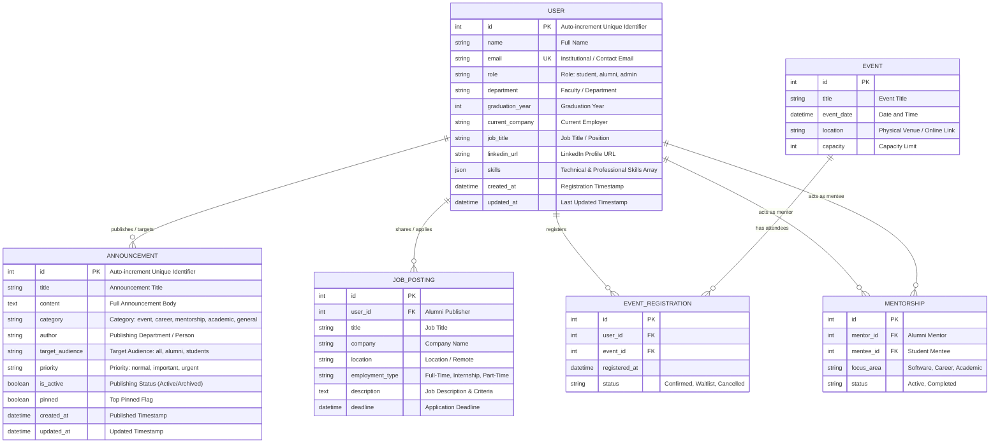

# 📊 Data Design Documentation (DDD)
## Alumni Tracking & Community Networking System

This document provides a comprehensive specification of the data architecture, data models, field definitions (Data Dictionary), cache and database persistence strategies, and relational data design for the **Alumni Tracking & Community Networking System**.

---

## 📑 Table of Contents
1. [System Data Architecture and Persistence Strategy](#1-system-data-architecture-and-persistence-strategy)
2. [Entity-Relationship Diagram (ERD)](#2-entity-relationship-diagram-erd)
3. [Detailed Data Dictionary](#3-detailed-data-dictionary)
   - [3.1. User Entity](#31-user-entity)
   - [3.2. Announcement Entity](#32-announcement-entity)
   - [3.3. Future / Planned Entities (Job, Event, Mentorship)](#33-future--planned-entities)
4. [Data Access Layer (DAL) and CRUD Mechanics](#4-data-access-layer-dal-and-crud-mechanics)
5. [Data Integrity, Type Casting, and Security](#5-data-integrity-type-casting-and-security)
6. [Relational Database (MySQL 8.0) Migration Roadmap](#6-relational-database-mysql-80-migration-roadmap)

---

## 1. System Data Architecture and Persistence Strategy

The application adopts a **two-tier data persistence strategy** to maximize development agility, seamless portability, and operational scalability:

```
[Client / API / Web Form]
           │
           ▼
[Controller Layer (UserController / AnnouncementController)]
           │
           ▼
[Model Layer (App\Models\User / App\Models\Announcement)]
           │
 ┌─────────┴────────────────────────┐
 │ Phase 1: Current Implementation  │ Phase 2: Target Architecture
 ▼                                  ▼
[Laravel Cache Subsystem]          [MySQL 8.0 Relational DB]
(File / In-Memory Store)           (Eloquent ORM & Migrations)
- Key: 'alumni_users'              - Tables: users, announcements,
- Key: 'alumni_announcements'                events, job_postings...
```

### 1.1. Phase 1 (Current State): Database-Independent & Cache-Backed Persistence
- **Purpose:** Immediate zero-configuration readiness across local workstations and Docker environments without requiring an active external database connection or pre-migration steps.
- **Technology:** Laravel Cache Subsystem (`Illuminate\Support\Facades\Cache`).
- **Storage Keys (Cache Keys):**
  - `alumni_users`: Complete array collection of alumni, student, and administrator records.
  - `alumni_announcements`: Complete array collection of announcements, categories, priorities, and statuses.
- **Lifecycle & Retention:** Persisted with `Cache::forever()` throughout application execution. Can be reset to deterministic factory seed values at any time via API endpoints (`POST /api/users/reset`, `POST /api/announcements/reset`) or programmatically via model helpers (`reset()`).

### 1.2. Phase 2 (Target Architecture): MySQL 8.0 & Eloquent ORM
- Because models implement standard contracts (`ArrayAccess`, `Arrayable`, `Jsonable`, and `JsonSerializable`), migrating to MySQL tables and Eloquent ORM requires zero breaking changes to Controller logic or View templates.

---

## 2. Entity-Relationship Diagram (ERD)

The following diagram models the relationships between the active domain entities (`USER`, `ANNOUNCEMENT`) and planned system modules:



---

## 3. Detailed Data Dictionary

### 3.1. User Entity
The User model represents university alumni, current students, and system administrators.

- **Model Class:** `App\Models\User`
- **Cache Key:** `alumni_users`
- **Target Database Table:** `users`

| Field Name | Data Type (PHP) | Target SQL Type | Nullable? | Default | Business Rules & Description | Example Value |
| :--- | :--- | :--- | :---: | :--- | :--- | :--- |
| `id` | `int` | `BIGINT UNSIGNED AUTO_INCREMENT` | ❌ No | Auto | Unique record identifier. | `1` |
| `name` | `string` | `VARCHAR(191)` | ❌ No | `'Dilara Mumcu'` | User's full name. Required in all forms. | `'Dilara MUMCU'` |
| `email` | `string` | `VARCHAR(191) UNIQUE` | ❌ No | `'dilara@alumni.edu'` | Primary contact email. Must be globally unique. | `'dilara@ogr.iu.edu.tr'` |
| `role` | `string` | `ENUM('student','alumni','admin')` | ❌ No | `'alumni'` | User role governing permissions and visibility. | `'alumni'` |
| `department` | `string` | `VARCHAR(191)` | ❌ No | `'Computer Engineering'` | Academic department or faculty attended. | `'Computer Engineering'` |
| `graduation_year` | `?int` | `SMALLINT UNSIGNED` | ⚠️ Yes | `2024` | Graduation year. Valid range between 1950 and 2035. | `2024` |
| `current_company` | `?string` | `VARCHAR(191)` | ⚠️ Yes | `'Google'` | Current employer or affiliated institution. | `'Google DeepMind'` |
| `job_title` | `?string` | `VARCHAR(191)` | ⚠️ Yes | `'Software Engineer'` | Professional designation / job title. | `'Senior AI Engineer'` |
| `linkedin_url` | `?string` | `VARCHAR(255)` | ⚠️ Yes | `null` | Public LinkedIn profile URL. | `'https://linkedin.com/in/dilaramumcu'` |
| `skills` | `?array` | `JSON` | ⚠️ Yes | `['PHP','Laravel','Docker']` | Array of technical and professional skill endorsements. | `["PHP", "Laravel", "MySQL", "Docker"]` |
| `created_at` | `string` | `DATETIME / TIMESTAMP` | ❌ No | `now()` | ISO 8601 record creation timestamp. | `'2024-06-15T10:00:00Z'` |
| `updated_at` | `string` | `DATETIME / TIMESTAMP` | ❌ No | `now()` | ISO 8601 last modification timestamp. | `'2026-10-07T11:00:00Z'` |

---

### 3.2. Announcement Entity
The Announcement model represents news broadcasts, events, career/internship openings, and mentorship recruitment notices.

- **Model Class:** `App\Models\Announcement`
- **Cache Key:** `alumni_announcements`
- **Target Database Table:** `announcements`

| Field Name | Data Type (PHP) | Target SQL Type | Nullable? | Default | Business Rules & Description | Example Value |
| :--- | :--- | :--- | :---: | :--- | :--- | :--- |
| `id` | `int` | `BIGINT UNSIGNED AUTO_INCREMENT` | ❌ No | Auto | Unique announcement identifier. | `1` |
| `title` | `string` | `VARCHAR(255)` | ❌ No | — | Main announcement headline. Required. | `'2026 Alumni Summit'` |
| `content` | `string` | `TEXT` | ❌ No | — | Detailed announcement body text. | `'All graduates and students are welcome...'` |
| `category` | `string` | `ENUM('event','career','mentorship','academic','general')` | ❌ No | `'general'` | Category used for filtering and UI badge styling. | `'event'` |
| `author` | `?string` | `VARCHAR(191)` | ⚠️ Yes | `'Alumni Coordination Office'` | Department, association, or entity publishing the notice. | `'Career Center & Alumni Association'` |
| `target_audience`| `string` | `ENUM('all','alumni','students')` | ❌ No | `'all'` | Target audience filter. | `'all'` |
| `priority` | `string` | `ENUM('normal','important','urgent')` | ❌ No | `'normal'` | Urgency classification. Highlights urgent alerts in UI. | `'urgent'` |
| `is_active` | `bool` | `BOOLEAN` | ❌ No | `true` | Visibility flag (used for archiving old notices). | `true` |
| `pinned` | `bool` | `BOOLEAN` | ❌ No | `false` | Indicates whether the notice is pinned to top of lists. | `true` |
| `created_at` | `string` | `DATETIME / TIMESTAMP` | ❌ No | `now()` | ISO 8601 publication timestamp. | `'2026-04-01T09:00:00Z'` |
| `updated_at` | `string` | `DATETIME / TIMESTAMP` | ❌ No | `now()` | ISO 8601 last updated timestamp. | `'2026-04-01T09:00:00Z'` |

---

### 3.3. Future / Planned Entities

#### A. JobPosting (Job & Internship Opportunities)
- **Table:** `job_postings`
- **Fields:** `id`, `user_id` (FK), `title`, `company`, `location`, `employment_type` (full-time, part-time, internship), `description`, `application_url`, `deadline`, `created_at`, `updated_at`.
- **Relationship:** An alumni member (`User`) can publish multiple job or internship opportunities on behalf of their organization (`1:N`).

#### B. Event & EventRegistration (Events & Attendance)
- **Tables:** `events`, `event_registrations`
- **Fields (Event):** `id`, `title`, `description`, `event_date`, `location`, `capacity`, `created_at`.
- **Fields (Registration):** `id`, `user_id` (FK), `event_id` (FK), `registered_at`, `status` (confirmed, waitlist, cancelled).
- **Relationship:** Multiple users can RSVP to an event (Many-to-Many `N:M` resolved via the `event_registrations` pivot table).

#### C. Mentorship (Mentorship Pairing)
- **Table:** `mentorship_relationships`
- **Fields:** `id`, `mentor_id` (FK -> users.id), `mentee_id` (FK -> users.id), `status` (pending, active, completed), `start_date`, `end_date`, `notes`.
- **Relationship:** Dual user relationship between an alumni mentor and a student mentee (`User -> User`).

---

## 4. Data Access Layer (DAL) and CRUD Mechanics

Without requiring an external database, the models provide complete **Repository and Data Mapper** functionality:

### 4.1. CRUD Method Standards
Each model class implements the following standard method signatures:

```php
// CREATE
Model::create(array $attributes): self;

// READ
Model::all(): array<self>;
Model::find(int|string $id): ?self;
Model::where(string $key, mixed $value): array<self>;
Model::count(): int;
Model::exists(int|string $id): bool;

// UPDATE
$model->update(array $attributes, bool $fullReplacement = false): self;
Model::updateById(int|string $id, array $attributes, bool $fullReplacement = false): ?self;

// DELETE
$model->delete(): bool;
Model::deleteById(int|string $id): ?self;

// STATE MANAGEMENT
Model::reset(): array<self>;
```

### 4.2. PUT and PATCH Semantics
Data updates strictly conform to RFC-7231 standards:
- **PUT (Full Replacement):** Omitted fields are reset to null or their respective defaults.
- **PATCH (Partial Update):** Only supplied keys are modified; omitted fields preserve their existing values.

---

## 5. Data Integrity, Type Casting, and Security

### 5.1. Type Casting and Array Parsing
- **Skills:** Comma-separated strings submitted via HTML forms (`"PHP, Laravel, Docker"`) are automatically converted into sanitized string arrays (`['PHP', 'Laravel', 'Docker']`) at the model layer.
- **Boolean Flags (`is_active`, `pinned`):** Sanitized using `filter_var($val, FILTER_VALIDATE_BOOLEAN)` to handle `'1'`, `'true'`, `1`, and HTML form checkbox values uniformly.
- **Numeric Fields (`graduation_year`, `id`):** Strongly cast using `(int)` to guarantee integer safety.

### 5.2. Data Security and Sanitization
- **Payload Isolation:** Controller actions invoke `$request->except(['_token', '_method'])` to ensure internal form control fields do not contaminate model attributes.
- **CSRF Protection & Exemptions:** Web Blade forms mandate `@csrf`. To enable seamless Postman, cURL, and automated testing, `users/*` and `announcements/*` routes are exempted from CSRF verification in `bootstrap/app.php`.

---

## 6. Relational Database (MySQL 8.0) Migration Roadmap

Existing models are architected to map 1:1 to MySQL tables and Eloquent ORM.

### 6.1. Sample Users Migration (`database/migrations/xxxx_create_users_table.php`)
```php
Schema::create('users', function (Blueprint $table) {
    $table->id();
    $table->string('name');
    $table->string('email')->unique();
    $table->enum('role', ['student', 'alumni', 'admin'])->default('alumni');
    $table->string('department');
    $table->unsignedSmallInteger('graduation_year')->nullable();
    $table->string('current_company')->nullable();
    $table->string('job_title')->nullable();
    $table->string('linkedin_url')->nullable();
    $table->json('skills')->nullable();
    $table->timestamps();

    $table->index('role');
    $table->index('graduation_year');
});
```

### 6.2. Sample Announcements Migration (`database/migrations/xxxx_create_announcements_table.php`)
```php
Schema::create('announcements', function (Blueprint $table) {
    $table->id();
    $table->string('title');
    $table->text('content');
    $table->enum('category', ['event', 'career', 'mentorship', 'academic', 'general'])->default('general');
    $table->string('author')->nullable();
    $table->enum('target_audience', ['all', 'alumni', 'students'])->default('all');
    $table->enum('priority', ['normal', 'important', 'urgent'])->default('normal');
    $table->boolean('is_active')->default(true);
    $table->boolean('pinned')->default(false);
    $table->timestamps();

    $table->index(['pinned', 'created_at']);
    $table->index('category');
});
```

---

> 🔗 **Related Documents:**
> - System architecture and MVC overview: [`README.md`](README.md)
> - Interactive OpenAPI / Swagger specification: [`app/Http/SwaggerSpec.php`](app/Http/SwaggerSpec.php)
