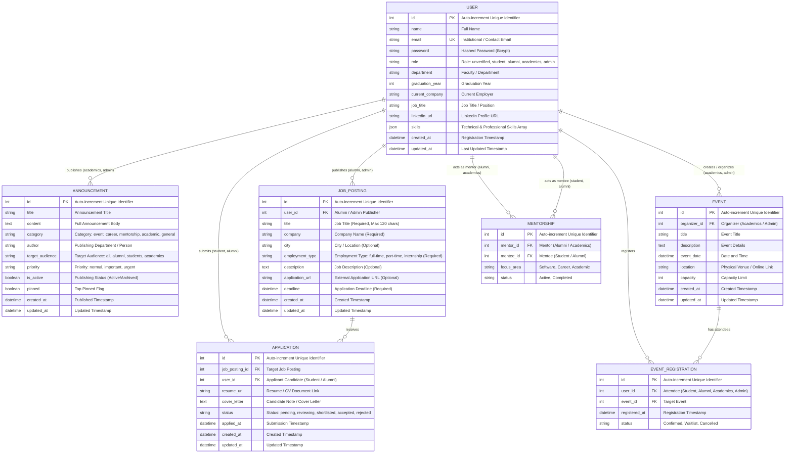

# 📊 Data Design Documentation (DDD)
## Alumni Tracking & Community Networking System

This document provides a comprehensive specification of the data architecture, data models, field definitions (Data Dictionary), cache and database persistence strategies, and relational data design for the **Alumni Tracking & Community Networking System**.

---

## 📑 Table of Contents
1. [System Data Architecture and Persistence Strategy](#1-system-data-architecture-and-persistence-strategy)
2. [Entity-Relationship Diagram (ERD)](#2-entity-relationship-diagram-erd)
3. [Detailed Data Dictionary](#3-detailed-data-dictionary)
   - [3.1. User Entity](#31-user-entity)
   - [3.2. Announcement Entity](#32-announcement-entity)
   - [3.3. Future / Planned Entities (JobPosting, Application, Event, Mentorship)](#33-future--planned-entities)
4. [User Roles and Authorization Architecture (RBAC)](#4-user-roles-and-authorization-architecture-rbac)
   - [4.1. Role Taxonomy and Definitions](#41-role-taxonomy-and-definitions)
   - [4.2. Role-Based Access Control (RBAC) Matrix](#42-role-based-access-control-rbac-matrix)
   - [4.3. Core Authorization Rules & Workflows](#43-core-authorization-rules--workflows)
   - [4.4. Technical Implementation Specification (Middleware, Policies, Gates)](#44-technical-implementation-specification)
5. [Data Access Layer (DAL) and CRUD Mechanics](#5-data-access-layer-dal-and-crud-mechanics)
6. [Data Integrity, Type Casting, and Security](#6-data-integrity-type-casting-and-security)
7. [Relational Database (MySQL 8.0) Migration Roadmap](#7-relational-database-mysql-80-migration-roadmap)

---

## 1. System Data Architecture and Persistence Strategy

The application adopts a **two-tier data persistence strategy** to maximize development agility, seamless portability, and operational scalability:

```
[Client / API / Web Form]
           │
           ▼
[Controller Layer (UserController / AnnouncementController)]
           │
           ▼
[Model Layer (App\Models\User / App\Models\Announcement)]
           │
 ┌─────────┴────────────────────────┐
 │ Phase 1: Current Implementation  │ Phase 2: Target Architecture
 ▼                                  ▼
[Laravel Cache Subsystem]          [MySQL 8.0 Relational DB]
(File / In-Memory Store)           (Eloquent ORM & Migrations)
- Key: 'alumni_users'              - Tables: users, announcements,
- Key: 'alumni_announcements'                job_postings, applications,
                                             events, mentorship...
```

### 1.1. Phase 1 (Current State): Database-Independent & Cache-Backed Persistence
- **Purpose:** Immediate zero-configuration readiness across local workstations and Docker environments without requiring an active external database connection or pre-migration steps.
- **Technology:** Laravel Cache Subsystem (`Illuminate\Support\Facades\Cache`).
- **Storage Keys (Cache Keys):**
  - `alumni_users`: Complete array collection of alumni, student, and administrator records.
  - `alumni_announcements`: Complete array collection of announcements, categories, priorities, and statuses.
- **Lifecycle & Retention:** Persisted with `Cache::forever()` throughout application execution. Can be reset to deterministic factory seed values at any time via API endpoints (`POST /api/users/reset`, `POST /api/announcements/reset`) or programmatically via model helpers (`reset()`).

### 1.2. Phase 2 (Target Architecture): MySQL 8.0 & Eloquent ORM
- Because models implement standard contracts (`ArrayAccess`, `Arrayable`, `Jsonable`, and `JsonSerializable`), migrating to MySQL tables and Eloquent ORM requires zero breaking changes to Controller logic or View templates.

---

## 2. Entity-Relationship Diagram (ERD)

The following diagram models the relationships between the active domain entities (`USER`, `ANNOUNCEMENT`) and planned system modules:



---

## 3. Detailed Data Dictionary

### 3.1. User Entity
The User model represents newly registered unverified accounts (`unverified`), university alumni (`alumni`), current students (`student`), academic staff/faculty (`academics`), and system administrators (`admin`). Unauthenticated visitors are represented at the application gateway as `guests`.

- **Model Class:** `App\Models\User`
- **Cache Key:** `alumni_users`
- **Target Database Table:** `users`

| Field Name | Data Type (PHP) | Target SQL Type | Nullable? | Default | Business Rules & Description | Example Value |
| :--- | :--- | :--- | :---: | :--- | :--- | :--- |
| `id` | `int` | `BIGINT UNSIGNED AUTO_INCREMENT` | ❌ No | Auto | Unique record identifier. | `1` |
| `name` | `string` | `VARCHAR(191)` | ❌ No | `'Dilara Mumcu'` | User's full name. Required in all forms. | `'Dilara MUMCU'` |
| `email` | `string` | `VARCHAR(191) UNIQUE` | ❌ No | `'dilara@alumni.edu'` | Primary contact email. Must be globally unique. | `'dilara@ogr.iu.edu.tr'` |
| `password` | `?string` | `VARCHAR(255)` | ⚠️ Yes | `null` | Bcrypt-hashed account password (`Hash::make()`). Required during self-registration (`/register`); hidden in JSON serialization. | `'$2y$12$...'` |
| `role` | `string` | `ENUM('unverified','student','alumni','academics','admin')` | ❌ No | `'unverified'` | User role governing permissions and system access control. Newly self-registered users default to `'unverified'` until institutional/admin verification is completed. Unauthenticated visitors operate as `guests`. | `'unverified'` |
| `department` | `string` | `VARCHAR(191)` | ❌ No | `'Computer Engineering'` | Academic department or faculty attended. | `'Computer Engineering'` |
| `graduation_year` | `?int` | `SMALLINT UNSIGNED` | ⚠️ Yes | `2024` | Graduation year. Valid range between 1950 and 2035 (null for faculty/staff). | `2024` |
| `current_company` | `?string` | `VARCHAR(191)` | ⚠️ Yes | `'Google'` | Current employer or affiliated institution. | `'Google DeepMind'` |
| `job_title` | `?string` | `VARCHAR(191)` | ⚠️ Yes | `'Software Engineer'` | Professional designation / job title. | `'Senior AI Engineer'` |
| `linkedin_url` | `?string` | `VARCHAR(255)` | ⚠️ Yes | `null` | Public LinkedIn profile URL. | `'https://linkedin.com/in/dilaramumcu'` |
| `skills` | `?array` | `JSON` | ⚠️ Yes | `['PHP','Laravel','Docker']` | Array of technical and professional skill endorsements. | `["PHP", "Laravel", "MySQL", "Docker"]` |
| `created_at` | `string` | `DATETIME / TIMESTAMP` | ❌ No | `now()` | ISO 8601 record creation timestamp. | `'2024-06-15T10:00:00Z'` |
| `updated_at` | `string` | `DATETIME / TIMESTAMP` | ❌ No | `now()` | ISO 8601 last modification timestamp. | `'2026-10-07T11:00:00Z'` |

---

### 3.2. Announcement Entity
The Announcement model represents news broadcasts, events, career/internship openings, and mentorship recruitment notices.

- **Model Class:** `App\Models\Announcement`
- **Cache Key:** `alumni_announcements`
- **Target Database Table:** `announcements`

| Field Name | Data Type (PHP) | Target SQL Type | Nullable? | Default | Business Rules & Description | Example Value |
| :--- | :--- | :--- | :---: | :--- | :--- | :--- |
| `id` | `int` | `BIGINT UNSIGNED AUTO_INCREMENT` | ❌ No | Auto | Unique announcement identifier. | `1` |
| `title` | `string` | `VARCHAR(255)` | ❌ No | — | Main announcement headline. Required. | `'2026 Alumni Summit'` |
| `content` | `string` | `TEXT` | ❌ No | — | Detailed announcement body text. | `'All graduates and students are welcome...'` |
| `category` | `string` | `ENUM('event','career','mentorship','academic','general')` | ❌ No | `'general'` | Category used for filtering and UI badge styling. | `'event'` |
| `author` | `?string` | `VARCHAR(191)` | ⚠️ Yes | `'Alumni Coordination Office'` | Department, association, or entity publishing the notice. | `'Career Center & Alumni Association'` |
| `target_audience`| `string` | `ENUM('all','alumni','students')` | ❌ No | `'all'` | Target audience filter. | `'all'` |
| `priority` | `string` | `ENUM('normal','important','urgent')` | ❌ No | `'normal'` | Urgency classification. Highlights urgent alerts in UI. | `'urgent'` |
| `is_active` | `bool` | `BOOLEAN` | ❌ No | `true` | Visibility flag (used for archiving old notices). | `true` |
| `pinned` | `bool` | `BOOLEAN` | ❌ No | `false` | Indicates whether the notice is pinned to top of lists. | `true` |
| `created_at` | `string` | `DATETIME / TIMESTAMP` | ❌ No | `now()` | ISO 8601 publication timestamp. | `'2026-04-01T09:00:00Z'` |
| `updated_at` | `string` | `DATETIME / TIMESTAMP` | ❌ No | `now()` | ISO 8601 last updated timestamp. | `'2026-04-01T09:00:00Z'` |

---

### 3.3. Future / Planned Entities

#### A. JobPosting (Job & Internship Opportunities)
The JobPosting entity represents career, employment, and internship opportunities published by alumni or partner organizations.

- **Model Class:** `App\Models\JobPosting`
- **Target Database Table:** `job_postings`
- **Foreign Keys:**
  - `user_id`: `BIGINT UNSIGNED FK -> users.id` (Alumni publisher, ON DELETE CASCADE)
- **Relationship:** An alumni member (`User`) can publish multiple job or internship opportunities on behalf of their organization (`1:N`). Each job posting receives multiple applications (`1:N`).

| Field Name | Data Type (PHP) | Target SQL Type | Nullable? | Default | Business Rules & Description | Example Value |
| :--- | :--- | :--- | :---: | :--- | :--- | :--- |
| `id` | `int` | `BIGINT UNSIGNED AUTO_INCREMENT` | ❌ No | Auto | Unique job posting record identifier. Primary Key. | `1` |
| `user_id` | `int` | `BIGINT UNSIGNED` | ❌ No | — | Foreign key referencing the publishing user (`users.id`). Required. | `5` |
| `title` | `string` | `VARCHAR(120)` | ❌ No | — | Job posting headline / role title. **Required, maximum 120 characters (`max:120`)**. | `'Senior Backend Engineer'` |
| `company` | `string` | `VARCHAR(191)` | ❌ No | — | Hiring company or organization name. **Required**. | `'Google'` |
| `city` | `?string` | `VARCHAR(191)` | ⚠️ Yes | `null` | City or geographic location of the position (`city` / `location`). **Optional (Nullable)**. | `'Istanbul'` |
| `employment_type` | `string` | `ENUM('full-time','part-time','internship')` | ❌ No | `'full-time'` | Employment classification. **Required**. Must be one of `full-time`, `part-time`, or `internship`. | `'full-time'` |
| `description` | `?string` | `TEXT` | ⚠️ Yes | `null` | Detailed role requirements, responsibilities, and qualifications. **Optional (Nullable)**. | `'Looking for an experienced engineer...'` |
| `deadline` | `string` / `DateTime` | `DATETIME / TIMESTAMP` | ❌ No | — | Application cutoff date and time. **Required**. | `'2026-12-31 23:59:59'` |
| `application_url` | `?string` | `VARCHAR(255)` | ⚠️ Yes | `null` | External career portal or application URL. **Optional (Nullable)**. | `'https://careers.google.com/jobs/123'` |
| `created_at` | `string` | `DATETIME / TIMESTAMP` | ❌ No | `now()` | Standard Eloquent creation timestamp. | `'2026-05-01T10:00:00Z'` |
| `updated_at` | `string` | `DATETIME / TIMESTAMP` | ❌ No | `now()` | Standard Eloquent last updated timestamp. | `'2026-05-05T12:00:00Z'` |

- **Integrity Constraints, Validation & Indexing:**
  - **Validation Rules:**
    - `title`: `required|string|max:120` (Must be present and not exceed 120 characters)
    - `company`: `required|string|max:191` (Must be present)
    - `city` (or `location`): `nullable|string|max:191` (Optional field)
    - `employment_type`: `required|in:full-time,part-time,internship` (Must be present with valid enum value)
    - `description`: `nullable|string` (Optional field)
    - `deadline`: `required|date` (Must be present with a valid date/timestamp)
    - `application_url`: `nullable|url|max:255` (Optional field)
    - `user_id`: `required|exists:users,id`
  - **Foreign Key Constraints:** Cascade on delete (`ON DELETE CASCADE`) ensures job postings and child applications are deleted when the publishing user is deleted.
  - **Indexes:** Secondary indexes on `(company)`, `(employment_type)`, `(deadline)`, and composite index on `(user_id, created_at)`.

#### B. Application (Job & Internship Applications)
The Application entity enables alumni and students to apply for published job postings, submitting contact resumes, portfolios, and cover letters while tracking review status.

- **Model Class (Planned):** `App\Models\Application`
- **Target Database Table:** `applications`
- **Foreign Keys:**
  - `job_posting_id`: `BIGINT UNSIGNED FK -> job_postings.id` (ON DELETE CASCADE)
  - `user_id`: `BIGINT UNSIGNED FK -> users.id` (applicant candidate, ON DELETE CASCADE)
- **Relationship:** A candidate (`User`) submits an application (`Application`) to a `JobPosting` (`N:1`). Each job posting receives multiple applications (`1:N`).

| Field Name | Data Type (PHP) | Target SQL Type | Nullable? | Default | Business Rules & Description | Example Value |
| :--- | :--- | :--- | :---: | :--- | :--- | :--- |
| `id` | `int` | `BIGINT UNSIGNED AUTO_INCREMENT` | ❌ No | Auto | Unique application record identifier. Primary Key. | `1` |
| `job_posting_id` | `int` | `BIGINT UNSIGNED` | ❌ No | — | Foreign key referencing the target job posting (`job_postings.id`). | `10` |
| `user_id` | `int` | `BIGINT UNSIGNED` | ❌ No | — | Foreign key referencing the applicant candidate (`users.id`). | `42` |
| `resume_url` | `?string` | `VARCHAR(255)` | ⚠️ Yes | `null` | Direct URL link to applicant's external CV, portfolio, or uploaded PDF document. | `'https://storage.alumni.edu/cvs/dilara_resume.pdf'` |
| `cover_letter` | `?string` | `TEXT` | ⚠️ Yes | `null` | Candidate's personal statement, intro message, or motivation letter. | `'I am excited to apply for the Senior AI Engineer role...'` |
| `status` | `string` | `ENUM('pending','reviewing','shortlisted','accepted','rejected')` | ❌ No | `'pending'` | Current state in the hiring pipeline. Updated by posting author/admin. | `'reviewing'` |
| `applied_at` | `string` | `DATETIME / TIMESTAMP` | ❌ No | `CURRENT_TIMESTAMP` | Timestamp when the application was originally lodged. | `'2026-05-10T14:30:00Z'` |
| `created_at` | `string` | `DATETIME / TIMESTAMP` | ❌ No | `now()` | Standard Eloquent creation timestamp. | `'2026-05-10T14:30:00Z'` |
| `updated_at` | `string` | `DATETIME / TIMESTAMP` | ❌ No | `now()` | Standard Eloquent last updated timestamp. | `'2026-05-12T09:15:00Z'` |

- **Integrity Constraints & Indexing:**
  - **Unique Index:** `UNIQUE(job_posting_id, user_id)` — Prevents duplicate active applications from the same user to the same job posting.
  - **Foreign Key Constraints:** Cascade on delete (`ON DELETE CASCADE`) ensures applications are cleaned up if the job posting or user account is purged.
  - **Indexes:** Secondary indexes on `(job_posting_id)`, `(user_id)`, and `(status)` to guarantee fast employer applicant filtering and candidate dashboard queries.

#### C. Event & EventRegistration (Events & Attendance)
- **Tables:** `events`, `event_registrations`
- **Fields (Event):** `id`, `organizer_id` (BIGINT UNSIGNED FK -> users.id, restricted to `academics` and `admin`), `title`, `description`, `event_date`, `location`, `capacity`, `created_at`, `updated_at`.
- **Fields (Registration):** `id`, `user_id` (FK -> users.id), `event_id` (FK -> events.id), `registered_at`, `status` (confirmed, waitlist, cancelled).
- **Relationship:** Multiple users can RSVP to an event (Many-to-Many `N:M` resolved via the `event_registrations` pivot table). An academic or admin user organizes multiple events (`1:N`).

#### D. Mentorship (Mentorship Pairing)
- **Table:** `mentorship_relationships`
- **Fields:** `id`, `mentor_id` (FK -> users.id, restricted to `alumni` and `academics`), `mentee_id` (FK -> users.id, restricted to `student` and junior `alumni`), `status` (pending, active, completed), `start_date`, `end_date`, `notes`.
- **Relationship:** Dual user relationship between an alumni/academic mentor and a student/alumni mentee (`User -> User`).

---

## 4. User Roles and Authorization Architecture (RBAC)

The application enforces a comprehensive **Role-Based Access Control (RBAC)** architecture that governs access boundaries, onboarding verification states, identity segregation, and domain operational rights.

### 4.1. Role Taxonomy and Definitions

| Role Identifier | Role Name | Intended Audience | Authentication Status | Core Architectural Scope |
| :--- | :--- | :--- | :---: | :--- |
| **`guests`** | **Guest / Anonymous Visitor** | Prospective students, public visitors, recruiters. | Unauthenticated (`Auth::guest()`) | Public landing page, general announcements, public event calendar preview, and access to `/register`. Read-only, no write access. |
| **`unverified`** | **Unverified New User** | First-time users who have registered via `/register` and **have not yet completed verification**. | Authenticated (`role = 'unverified'`) | Default onboarding role assigned automatically upon initial registration. Can view public/portal listings and view/update their own profile, but **cannot** apply to jobs, publish job postings, create/register for events, or join mentorship until verification is completed (verification completion is intentionally deferred to a separate workflow). |
| **`student`** | **Active University Student** | Verified undergraduate, graduate, and PhD students. | Authenticated (`role = 'student'`) | Verified student portal access. **Can apply to jobs/internships**, track applications, search alumni directory, RSVP to events, request mentorship. |
| **`alumni`** | **Graduated Alumnus / Alumna** | Verified Istanbul University graduates. | Authenticated (`role = 'alumni'`) | Verified alumni network access. **Can apply to jobs**, publish company job listings, review applicant candidates, RSVP to events, act as mentors. |
| **`academics`** | **Academician & Faculty Member**| Verified professors, docents, lecturers, research assistants. | Authenticated (`role = 'academics'`) | Academic authority. **Can create and manage campus events**, publish academic announcements, supervise student research, provide academic mentorship. |
| **`admin`** | **System & Portal Administrator** | Rectorate, Career Center, IT Operations. | Authenticated (`role = 'admin'`) | Full administrative oversight. **Can create events**, verify `unverified` accounts and assign roles, verify/moderate job postings, manage announcements, inspect audit logs. |

---

### 4.2. Role-Based Access Control (RBAC) Matrix

The table below details explicit authorization capabilities across every system domain, including the **`unverified`** onboarding tier:

| Feature / Domain Module | Action / Endpoint | `guests` | `unverified` | `student` | `alumni` | `academics` | `admin` | Business Authorization Rule |
| :--- | :--- | :---: | :---: | :---: | :---: | :---: | :---: | :--- |
| **Public Portal & Landing** | `GET /` | ✅ Read | ✅ Read | ✅ Read | ✅ Read | ✅ Read | ✅ Read | Open public access to all visitors. |
| **First-Time Registration** | `GET/POST /register` | ✅ Register | 🔄 Redirect | 🔄 Redirect | 🔄 Redirect | 🔄 Redirect | 🔄 Redirect | Creates account with forced `role = 'unverified'`. |
| **Directory & Network** | `GET /users` | ⚠️ Limited | ⚠️ Read-Only | ✅ Full | ✅ Full | ✅ Full | ✅ Full | Guests see aggregate counters; `unverified` has read-only preview; verified members have full networking. |
| **Own Profile Viewing / Editing**| `GET/PUT /users/{id}` | ❌ Denied | 👤 Own Only | 👤 Own Only | 👤 Own Only | 👤 Own Only | ✅ All | `unverified` and verified users can edit their own profile fields (excluding `role`); Admin edits any record. |
| **Role Assignment & Verification**| `PATCH /users/{id}/role` | ❌ Denied | ❌ Denied | ❌ Denied | ❌ Denied | ❌ Denied | ✅ Admin | **Strictly Admin-only** (or future automated verification workflow). Prevents privilege escalation. |
| **Job Postings Viewing** | `GET /job-postings` | ✅ Read | ✅ Read | ✅ Read | ✅ Read | ✅ Read | ✅ Read | Public visibility to maximize career opportunity outreach. |
| **Job Posting Publishing** | `POST /job-postings` | ❌ Denied | ❌ Denied | ❌ Denied | ✅ **Alumni** | ❌ Denied | ✅ **Admin** | **Alumni** publish company positions; **Admin** has supervisory publishing rights. |
| **Job Posting Editing / Deletion**| `PUT/DELETE /job-postings/{id}` | ❌ Denied | ❌ Denied | ❌ Denied | 👤 Author Only | ❌ Denied | ✅ All | Alumni can only edit their own postings (`user_id == auth()->id()`). |
| **Job Applications (Apply)** | `POST /applications` | ❌ Denied | ❌ Denied | ✅ **Apply** | ✅ **Apply** | ❌ Denied | ⚠️ Audit | **Only verified `student` and `alumni` roles can apply for jobs.** `unverified` users must complete verification first. |
| **Own Applications Tracking**| `GET /applications/me` | ❌ Denied | ❌ Denied | ✅ Own | ✅ Own | ❌ Denied | ✅ All | Verified candidates track submission statuses (`pending`, `reviewing`, etc.). |
| **Applicant Review (Employer)**| `GET /job-postings/{id}/apps` | ❌ Denied | ❌ Denied | ❌ Denied | 👤 Author Only | ❌ Denied | ✅ All | Alumni review candidates who applied to their postings; Admin can audit all. |
| **Application Status Update** | `PATCH /applications/{id}` | ❌ Denied | ❌ Denied | ❌ Denied | 👤 Author Only | ❌ Denied | ✅ All | Posting authors and Admins accept, reject, or shortlist applicants. |
| **Announcements Viewing** | `GET /announcements` | ✅ Read | ✅ Read | ✅ Read | ✅ Read | ✅ Read | ✅ Read | Public access to university and alumni announcements. |
| **Announcement Creation** | `POST /announcements` | ❌ Denied | ❌ Denied | ❌ Denied | ❌ Denied | ✅ **Publish** | ✅ **Publish** | **Academics** publish academic/faculty notices; **Admin** publishes institutional news. |
| **Announcement Moderation** | `PUT/DELETE /announcements/{id}`| ❌ Denied | ❌ Denied | ❌ Denied | ❌ Denied | 👤 Author Only | ✅ All | Authors modify their notices; Admin can pin, archive, or delete any notice. |
| **Events Viewing** | `GET /events` | ✅ Read | ✅ Read | ✅ Read | ✅ Read | ✅ Read | ✅ Read | Open event calendar, seminars, summits, and workshop listings. |
| **Event Creation** | `POST /events` | ❌ Denied | ❌ Denied | ❌ Denied | ❌ Denied | ✅ **Create** | ✅ **Create** | **Admins and academics create events** (conferences, panels, workshops, seminars). |
| **Event Management** | `PUT/DELETE /events/{id}` | ❌ Denied | ❌ Denied | ❌ Denied | ❌ Denied | 👤 Organizer | ✅ All | Academics manage their organized events; Admin oversees all events and quotas. |
| **Event RSVP / Registration** | `POST /events/{id}/register` | ❌ Denied | ❌ Denied | ✅ Register | ✅ Register | ✅ Register | ✅ Register | Verified university community members can register for event attendance. |
| **Mentorship (As Mentee)** | `POST /mentorship/request` | ❌ Denied | ❌ Denied | ✅ Mentee | ✅ Mentee | ❌ Denied | ⚠️ Manage | Verified students and junior alumni can request mentorship pairings. |
| **Mentorship (As Mentor)** | `POST /mentorship/offer` | ❌ Denied | ❌ Denied | ❌ Denied | ✅ Mentor | ✅ Mentor | ⚠️ Manage | Verified alumni and academics can register to mentor students. |
| **System Cache & Diagnostics**| `POST /api/*/reset`, `/logs` | ❌ Denied | ❌ Denied | ❌ Denied | ❌ Denied | ❌ Denied | ✅ Admin | Diagnostic panels, cache resets, and error log telemetry inspection. |

---

### 4.3. Core Authorization Rules & Workflows

#### 0. First-Time User Registration & `unverified` Onboarding State (`GET /register`, `POST /register`)
- **Core Rule:** Any first-time visitor registering through the public registration portal (`POST /register` or `POST /api/register`) is **strictly and automatically assigned `role = 'unverified'`**. Client-supplied `role` inputs are ignored during registration to prevent privilege escalation.
- **Verification Scope Note:** The verification completion subsystem (institutional email token confirmation / diploma check / admin approval workflow) is **intentionally decoupled and not executed during registration**; newly registered accounts remain in the `unverified` state with a clear pending-verification notice until promoted.
- **Registration Form Inputs & Validation Contract:**
  - `name` (`required|string|min:2|max:191`) — Full Name
  - `email` (`required|string|email|max:191|unique:users,email`) — Institutional or personal contact email
  - `password` (`required|string|min:8|confirmed`) — Account password + `password_confirmation`
  - `department` (`required|string|max:191`) — Academic Faculty / Department
  - `graduation_year` (`nullable|integer|min:1950|max:2035`) — Graduation or expected graduation year
  - `current_company` (`nullable|string|max:191`) — Current employer / institution
  - `job_title` (`nullable|string|max:191`) — Current job title / academic designation
  - `linkedin_url` (`nullable|url|max:255`) — Public LinkedIn profile URL
  - `skills` (`nullable|string|max:500`) — Comma-separated technical/professional skills (auto-cast to JSON array)
  - `terms` (`accepted` on web form) — Institutional terms & KVKK consent acknowledgment
- **Onboarding Lifecycle:**
  ```
  [Guest Visitor] ──(POST /register)──► [User Created: role = 'unverified']
                                                │
                                 (Session Auth::login($user))
                                                │
                                                ▼
                          [Profile Page w/ "Pending Verification" Status]
                          (Restricted from applying to jobs / creating events
                           until future verification step promotes role to
                           'student', 'alumni', or 'academics')
  ```

#### 1. Job Applications Authorization (`student` & `alumni`)
- **Core Rule:** Only verified **Students** and **Alumni** possess authorization to submit applications to job postings (`POST /applications`). Users with `role = 'unverified'` cannot submit job applications until verified.
- **Authorization Gate:**
  ```php
  Gate::define('apply-job', function (User $user) {
      return in_array($user->role, ['student', 'alumni'], true);
  });
  ```
- **Domain Workflow:**
  1. A candidate visits a job posting detail page (`GET /job-postings/{id}`).
  2. If the user is unauthenticated (`guests`), the UI displays a `"Giriş Yaparak Başvur"` button redirecting to login/registration.
  3. If authenticated as `unverified`, the UI informs the user that account verification is pending before job applications are unlocked.
  4. If authenticated as `student` or `alumni`, the `"Hemen Başvur"` action form is enabled.
  5. If an `unverified` or `academics` user submits directly to the endpoint, the application gate rejects the submission with `403 Forbidden` (`'Yalnızca doğrulanmış öğrenciler ve mezunlar iş başvurusu yapabilir.'`).
  6. The submission records candidate `user_id` and attaches resume link and motivation note.

#### 2. Event Creation & Management Authorization (`academics` & `admin`)
- **Core Rule:** Only **Academics** and **Administrators** can create and schedule university events (`POST /events`).
- **Authorization Gate:**
  ```php
  Gate::define('create-event', function (User $user) {
      return in_array($user->role, ['academics', 'admin'], true);
  });
  ```
- **Domain Workflow:**
  1. Academics (professors, docents, lecturers) and Admins can access `GET /events/create`.
  2. The creation button is conditionally hidden from `unverified`, `student`, `alumni`, and `guests` via `@can('create-event')`.
  3. When submitted, the system verifies `in_array(auth()->user()->role, ['academics', 'admin'])`.
  4. The event is linked to `organizer_id = auth()->id()`.
  5. Unauthorized creation attempts return `403 Forbidden` (`'Etkinlik oluşturma yetkisi yalnızca akademisyenler ve yöneticilere aittir.'`).

#### 3. Job Posting Publishing Authorization (`alumni` & `admin`)
- **Core Rule:** Only **Alumni** (sharing career openings from their employers) and **Administrators** can publish job listings (`POST /job-postings`).
- **Authorization Gate:**
  ```php
  Gate::define('create-job-posting', function (User $user) {
      return in_array($user->role, ['alumni', 'admin'], true);
  });
  ```

#### 4. Official Announcements Authorization (`academics` & `admin`)
- **Core Rule:** Only **Academics** (departmental notices, symposiums, exams) and **Administrators** (rectorate press releases, university alerts) can broadcast announcements (`POST /announcements`).

#### 5. Role Assignment & Account Verification (`admin` only)
- **Core Rule:** Role changes (`PATCH /users/{id}/role`, such as promoting an `unverified` user to `student`, `alumni`, or `academics`) can only be executed by the `admin` role (or a dedicated future verification service). No user can self-promote or alter their own authorization level.

---

### 4.4. Technical Implementation Specification

The application enforces authorization across multiple defensive boundaries:

#### A. Route Middleware (`App\Http\Middleware\EnsureUserRole`)
```php
namespace App\Http\Middleware;

use Closure;
use Illuminate\Http\Request;
use Symfony\Component\HttpFoundation\Response;

class EnsureUserRole
{
    /**
     * Handle incoming request and verify user role against allowed list.
     *
     * @param  \Illuminate\Http\Request  $request
     * @param  \Closure  $next
     * @param  string  ...$roles Allowed role names
     */
    public function handle(Request $request, Closure $next, string ...$roles): Response
    {
        if (!auth()->check()) {
            return redirect()->guest('/register')->with('warning', 'Lütfen devam etmek için kayıt olun veya giriş yapınız.');
        }

        if ($request->user()->role === 'unverified' && !in_array('unverified', $roles, true)) {
            abort(403, 'Hesabınız henüz doğrulanmamıştır. Bu özelliği kullanmak için doğrulama aşamasının tamamlanması gerekmektedir.');
        }

        if (!in_array($request->user()->role, $roles, true)) {
            abort(403, 'Bu işlem için yetkiniz bulunmamaktadır.');
        }

        return $next($request);
    }
}
```

#### B. Laravel Policies (Entity-Level Authorization)

##### 1. ApplicationPolicy (`App\Policies\ApplicationPolicy`)
```php
namespace App\Policies;

use App\Models\User;
use App\Models\Application;
use App\Models\JobPosting;

class ApplicationPolicy
{
    /**
     * Determine whether the user can apply for a job posting.
     * Rule: Only verified students and alumni can apply for jobs.
     */
    public function apply(User $user, JobPosting $jobPosting): bool
    {
        return in_array($user->role, ['student', 'alumni'], true);
    }

    /**
     * Determine whether the user can view the application details.
     */
    public function view(User $user, Application $application): bool
    {
        return $user->id === $application->user_id
            || $user->id === $application->jobPosting->user_id
            || $user->role === 'admin';
    }

    /**
     * Determine whether the user can update the application status.
     */
    public function updateStatus(User $user, Application $application): bool
    {
        return $user->id === $application->jobPosting->user_id
            || $user->role === 'admin';
    }
}
```

##### 2. EventPolicy (`App\Policies\EventPolicy`)
```php
namespace App\Policies;

use App\Models\User;
use App\Models\Event;

class EventPolicy
{
    /**
     * Determine whether the user can create an event.
     * Rule: Admins and academics can create events.
     */
    public function create(User $user): bool
    {
        return in_array($user->role, ['academics', 'admin'], true);
    }

    /**
     * Determine whether the user can edit or delete an event.
     */
    public function update(User $user, Event $event): bool
    {
        return $user->id === $event->organizer_id || $user->role === 'admin';
    }

    /**
     * Determine whether the user can register for an event.
     * Rule: Only verified community members can register.
     */
    public function register(User $user, Event $event): bool
    {
        return in_array($user->role, ['student', 'alumni', 'academics', 'admin'], true);
    }
}
```

#### C. User Model Declarative Role Helpers (`App\Models\User`)
```php
public function isGuest(): bool       { return !auth()->check(); }
public function isUnverified(): bool  { return $this->role === 'unverified'; }
public function isVerified(): bool    { return $this->role !== 'unverified'; }
public function isStudent(): bool     { return $this->role === 'student'; }
public function isAlumni(): bool      { return $this->role === 'alumni'; }
public function isAcademics(): bool   { return $this->role === 'academics'; }
public function isAdmin(): bool       { return $this->role === 'admin'; }

// Domain Capability Predicates
public function canApplyToJobs(): bool  { return in_array($this->role, ['student', 'alumni'], true); }
public function canCreateEvents(): bool { return in_array($this->role, ['academics', 'admin'], true); }
public function canPublishJobs(): bool  { return in_array($this->role, ['alumni', 'admin'], true); }
```

#### D. Declarative Blade Directives in Views
```blade
{{-- 1. Job Application Button: Visible only to verified students & alumni --}}
@auth
    @if (auth()->user()->canApplyToJobs())
        <a href="/applications/create?job_posting_id={{ $job->id }}" class="btn btn-primary">
            Başvuru Yap
        </a>
    @elseif (auth()->user()->isUnverified())
        <span class="badge-pill badge-neutral">Doğrulama Bekleniyor</span>
    @endif
@else
    <a href="/register" class="btn btn-secondary">
        Kayıt Ol ve Başvur
    </a>
@endauth

{{-- 2. Event Creation Button: Visible only to academics & admin --}}
@auth
    @if (auth()->user()->canCreateEvents())
        <a href="/events/create" class="btn btn-primary">
            Yeni Etkinlik Düzenle
        </a>
    @endif
@endauth
```

---

## 5. Data Access Layer (DAL) and CRUD Mechanics

Without requiring an external database, the models provide complete **Repository and Data Mapper** functionality:

### 5.1. CRUD Method Standards
Each model class implements the following standard method signatures:

```php
// CREATE
Model::create(array $attributes): self;

// READ
Model::all(): array<self>;
Model::find(int|string $id): ?self;
Model::where(string $key, mixed $value): array<self>;
Model::count(): int;
Model::exists(int|string $id): bool;

// UPDATE
$model->update(array $attributes, bool $fullReplacement = false): self;
Model::updateById(int|string $id, array $attributes, bool $fullReplacement = false): ?self;

// DELETE
$model->delete(): bool;
Model::deleteById(int|string $id): ?self;

// STATE MANAGEMENT
Model::reset(): array<self>;
```

### 5.2. PUT and PATCH Semantics
Data updates strictly conform to RFC-7231 standards:
- **PUT (Full Replacement):** Omitted fields are reset to null or their respective defaults.
- **PATCH (Partial Update):** Only supplied keys are modified; omitted fields preserve their existing values.

---

## 6. Data Integrity, Type Casting, and Security

### 6.1. Type Casting and Array Parsing
- **Skills:** Comma-separated strings submitted via HTML forms (`"PHP, Laravel, Docker"`) are automatically converted into sanitized string arrays (`['PHP', 'Laravel', 'Docker']`) at the model layer.
- **Boolean Flags (`is_active`, `pinned`):** Sanitized using `filter_var($val, FILTER_VALIDATE_BOOLEAN)` to handle `'1'`, `'true'`, `1`, and HTML form checkbox values uniformly.
- **Numeric Fields (`graduation_year`, `id`):** Strongly cast using `(int)` to guarantee integer safety.

### 6.2. Data Security and Sanitization
- **Payload Isolation:** Controller actions invoke `$request->except(['_token', '_method'])` to ensure internal form control fields do not contaminate model attributes.
- **CSRF Protection & Exemptions:** Web Blade forms mandate `@csrf`. To enable seamless Postman, cURL, and automated testing, `users/*`, `announcements/*`, `job-postings/*`, and `applications/*` routes are exempted from CSRF verification in `bootstrap/app.php`.

### 6.3. Exception Handling, Error Guardians & Audit Telemetry
To ensure reliability and prevent uncaught domain errors from disrupting user experience:
- **404 Guardian (`Guardian404Middleware`):** Catches missing domain models (`ModelNotFoundException`) and invalid URLs (`NotFoundHttpException`). Resolves human-readable failure reasons, redirects browser requests to `/404` with state details, and returns JSON error schemas for API callers.
- **5xx Guardian (`Guardian5xxMiddleware`):** Catches server exceptions (`5xx`), hides internal server stack traces from public disclosure, and provides contextual problem descriptions.
- **Error Log Telemetry (`logs/error.logs`):** Automatically logs all 4xx/5xx errors via `ErrorLogWriter` with timestamp, status, method, route, IP, execution duration, descriptive reason, and exception class/trace coordinates. Deduplication flags prevent redundant log entries within the same request lifecycle.
- **Generic 404 Presentation (`resources/views/errors/404.blade.php`):** Implements an accessible fallback UI displaying error diagnostics, a 5-second auto-redirect countdown returning the user safely to `/`, and a pause control.

---

## 7. Relational Database (MySQL 8.0) Migration Roadmap

Existing models are architected to map 1:1 to MySQL tables and Eloquent ORM.

### 7.1. Sample Users Migration (`database/migrations/xxxx_create_users_table.php`)
```php
Schema::create('users', function (Blueprint $table) {
    $table->id();
    $table->string('name');
    $table->string('email')->unique();
    $table->string('password')->nullable();
    $table->enum('role', ['unverified', 'student', 'alumni', 'academics', 'admin'])->default('unverified');
    $table->string('department');
    $table->unsignedSmallInteger('graduation_year')->nullable();
    $table->string('current_company')->nullable();
    $table->string('job_title')->nullable();
    $table->string('linkedin_url')->nullable();
    $table->json('skills')->nullable();
    $table->rememberToken();
    $table->timestamps();

    $table->index('role');
    $table->index('graduation_year');
});
```

### 7.2. Sample Announcements Migration (`database/migrations/xxxx_create_announcements_table.php`)
```php
Schema::create('announcements', function (Blueprint $table) {
    $table->id();
    $table->string('title');
    $table->text('content');
    $table->enum('category', ['event', 'career', 'mentorship', 'academic', 'general'])->default('general');
    $table->string('author')->nullable();
    $table->enum('target_audience', ['all', 'alumni', 'students', 'academics'])->default('all');
    $table->enum('priority', ['normal', 'important', 'urgent'])->default('normal');
    $table->boolean('is_active')->default(true);
    $table->boolean('pinned')->default(false);
    $table->timestamps();

    $table->index(['pinned', 'created_at']);
    $table->index('category');
});
```

### 7.3. Sample Job Postings Migration (`database/migrations/xxxx_create_job_postings_table.php`)
```php
Schema::create('job_postings', function (Blueprint $table) {
    $table->id();
    $table->foreignId('user_id')->constrained('users')->cascadeOnDelete();
    $table->string('title', 120); // Required, max 120 characters
    $table->string('company'); // Required
    $table->string('city')->nullable(); // Optional city / location
    $table->enum('employment_type', ['full-time', 'part-time', 'internship'])->default('full-time'); // Required
    $table->text('description')->nullable(); // Optional description
    $table->string('application_url')->nullable(); // Optional application URL
    $table->dateTime('deadline'); // Required deadline
    $table->timestamps();

    $table->index('company');
    $table->index('employment_type');
    $table->index('deadline');
});
```

### 7.4. Sample Applications Migration (`database/migrations/xxxx_create_applications_table.php`)
```php
Schema::create('applications', function (Blueprint $table) {
    $table->id();
    $table->foreignId('job_posting_id')->constrained('job_postings')->onDelete('cascade');
    $table->foreignId('user_id')->constrained('users')->onDelete('cascade');
    $table->string('resume_url')->nullable();
    $table->text('cover_letter')->nullable();
    $table->enum('status', ['pending', 'reviewing', 'shortlisted', 'accepted', 'rejected'])->default('pending');
    $table->timestamp('applied_at')->useCurrent();
    $table->timestamps();

    $table->unique(['job_posting_id', 'user_id']);
    $table->index('status');
    $table->index(['job_posting_id', 'status']);
});
```

### 7.5. Sample Events Migration (`database/migrations/xxxx_create_events_table.php`)
```php
Schema::create('events', function (Blueprint $table) {
    $table->id();
    $table->foreignId('organizer_id')->constrained('users')->cascadeOnDelete(); // Academics or Admin
    $table->string('title');
    $table->text('description');
    $table->dateTime('event_date');
    $table->string('location');
    $table->unsignedInteger('capacity')->nullable();
    $table->timestamps();

    $table->index('event_date');
    $table->index('organizer_id');
});
```

---

> 🔗 **Related Documents:**
> - System architecture and MVC overview: [`README.md`](README.md)
> - Interactive OpenAPI / Swagger specification: [`app/Http/SwaggerSpec.php`](app/Http/SwaggerSpec.php)
