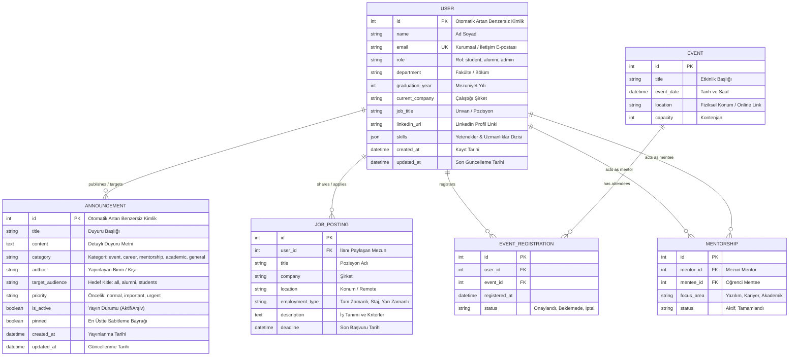

# 📊 Data Design Documentation (DDD)
## Alumni Tracking & Community Networking System

Bu doküman, **Alumni Tracking & Community Networking System** uygulamasının veri mimarisini, veri modellerini, alan tanımlarını (Data Dictionary), önbellek ve veritabanı persistans stratejilerini ve ilişkisel veri tasarımını ayrıntılı olarak belgelemektedir.

---

## 📑 İçindekiler
1. [Sistem Veri Mimarisi ve Persistans Stratejisi](#1-sistem-veri-mimarisi-ve-persistans-stratejisi)
2. [Varlık-İlişki Diyagramı (ERD)](#2-varlık-ilişki-diyagramı-erd)
3. [Detaylı Veri Sözlüğü (Data Dictionary)](#3-detaylı-veri-sözlüğü-data-dictionary)
   - [3.1. User (Kullanıcı) Varlığı](#31-user-kullanıcı-varlığı)
   - [3.2. Announcement (Duyuru) Varlığı](#32-announcement-duyuru-varlığı)
   - [3.3. Gelecek / Planlanan Varlıklar (Job, Event, Mentorship)](#33-gelecek--planlanan-varlıklar)
4. [Veri Erişim Katmanı (DAL) ve CRUD Mekaniği](#4-veri-erişim-katmanı-dal-ve-crud-mekaniği)
5. [Veri Bütünlüğü, Tip Dönüşümleri ve Güvenlik](#5-veri-bütünlüğü-tip-dönüşümleri-ve-güvenlik)
6. [İlişkisel Veritabanına (MySQL 8.0) Geçiş Yol Haritası](#6-ilişkisel-veritabanına-mysql-80-geçiş-yol-haritası)

---

## 1. Sistem Veri Mimarisi ve Persistans Stratejisi

Uygulama, geliştirme ve operasyonel esnekliği maksimize etmek amacıyla **iki aşamalı bir veri persistans stratejisi** izlemektedir:

```
[İstemci / API / Web Form]
           │
           ▼
[Controller Katmanı (UserController / AnnouncementController)]
           │
           ▼
[Model Katmanı (App\Models\User / App\Models\Announcement)]
           │
 ┌─────────┴────────────────────────┐
 │ Aşama 1: Mevcut Uygulama          │ Aşama 2: Hedef Mimari
 ▼                                  ▼
[Laravel Cache Subsystem]          [MySQL 8.0 Relational DB]
(File / In-Memory Store)           (Eloquent ORM & Migrations)
- Key: 'alumni_users'              - Tables: users, announcements,
- Key: 'alumni_announcements'                events, job_postings...
```

### 1.1. Aşama 1 (Mevcut Durum): Database-Independent & Cache-Backed Persistence
- **Amaç:** Harici bir veritabanı bağlantısı veya migrasyon bağımlılığı olmadan, Docker konteynerlerinde ve yerel ortamlarda sıfır yapılandırmayla anında çalışabilirlik.
- **Teknoloji:** Laravel Cache Subsystem (`Illuminate\Support\Facades\Cache`).
- **Kayıt Anahtarları (Cache Keys):**
  - `alumni_users`: Tüm mezun ve öğrenci kayıtlarını tutan liste.
  - `alumni_announcements`: Tüm duyuruları ve durumlarını tutan liste.
- **Yaşam Döngüsü & Saklama:** `Cache::forever()` ile uygulama çalıştığı sürece kalıcıdır. İstendiğinde API (`/api/users/reset`, `/api/announcements/reset`) veya model üzerinden fabrika ayarlarına sıfırlanabilir (`reset()`).

### 1.2. Aşama 2 (Hedef Mimari): MySQL 8.0 & Eloquent ORM
- Modeller `ArrayAccess`, `Arrayable`, `Jsonable` ve `JsonSerializable` arayüzlerini uyguladığı için, MySQL tablolarına ve Eloquent ORM yapısına geçiş yapıldığında Controller ve View katmanlarında kod değişikliği gerekmeyecektir.

---

## 2. Varlık-İlişki Diyagramı (ERD)

Aşağıdaki diyagramda mevcut aktif varlıklar (`USER`, `ANNOUNCEMENT`) ile sistemin planlanan modülleri arasındaki ilişkiler modellenmiştir:



---

## 3. Detaylı Veri Sözlüğü (Data Dictionary)

### 3.1. User (Kullanıcı) Varlığı
Kullanıcı modeli, üniversite mezunlarını, aktif öğrencileri ve yöneticileri temsil eder.

- **Model Sınıfı:** `App\Models\User`
- **Cache Anahtarı:** `alumni_users`
- **Hedef Veritabanı Tablosu:** `users`

| Alan Adı | Veri Tipi (PHP) | Hedef SQL Tipi | Boş Olabilir? | Varsayılan | İş Mantığı & Açıklama | Örnek Değer |
| :--- | :--- | :--- | :---: | :--- | :--- | :--- |
| `id` | `int` | `BIGINT UNSIGNED AUTO_INCREMENT` | ❌ Hayır | Otomatik | Benzersiz kayıt tanımlayıcısı. | `1` |
| `name` | `string` | `VARCHAR(191)` | ❌ Hayır | `'Dilara Mumcu'` | Kullanıcının adı ve soyadı. Formlarda zorunludur. | `'Dilara MUMCU'` |
| `email` | `string` | `VARCHAR(191) UNIQUE` | ❌ Hayır | `'dilara@alumni.edu'` | İletişim e-posta adresi. Sistemde benzersiz olmalıdır. | `'dilara@ogr.iu.edu.tr'` |
| `role` | `string` | `ENUM('student','alumni','admin')` | ❌ Hayır | `'alumni'` | Kullanıcının sistemdeki rolü. Yetkilendirmeleri belirler. | `'alumni'` |
| `department` | `string` | `VARCHAR(191)` | ❌ Hayır | `'Computer Engineering'` | Mezun olunan veya okunan akademik bölüm. | `'Bilgisayar Mühendisliği'` |
| `graduation_year` | `?int` | `SMALLINT UNSIGNED` | ⚠️ Evet | `2024` | Mezuniyet yılı. 1950 - 2035 aralığında tamsayı. | `2024` |
| `current_company` | `?string` | `VARCHAR(191)` | ⚠️ Evet | `'Google'` | Mezunun şu anda çalıştığı şirket/kurum. | `'Google DeepMind'` |
| `job_title` | `?string` | `VARCHAR(191)` | ⚠️ Evet | `'Software Engineer'` | Çalıştığı pozisyon ve unvan. | `'Senior AI Engineer'` |
| `linkedin_url` | `?string` | `VARCHAR(255)` | ⚠️ Evet | `null` | LinkedIn profesyonel profil bağlantısı. | `'https://linkedin.com/in/dilaramumcu'` |
| `skills` | `?array` | `JSON` | ⚠️ Evet | `['PHP','Laravel','Docker']` | Sahip olunan teknik ve sosyal beceriler dizisi. | `["PHP", "Laravel", "MySQL", "Docker"]` |
| `created_at` | `string` | `DATETIME / TIMESTAMP` | ❌ Hayır | `now()` | ISO 8601 formatında oluşturulma zaman damgası. | `'2024-06-15T10:00:00Z'` |
| `updated_at` | `string` | `DATETIME / TIMESTAMP` | ❌ Hayır | `now()` | ISO 8601 formatında son güncelleme zaman damgası. | `'2026-10-07T11:00:00Z'` |

---

### 3.2. Announcement (Duyuru) Varlığı
Duyuru modeli; etkinlikler, staj/iş ilanları, mentorluk programları ve kurumsal bilgilendirmeleri temsil eder.

- **Model Sınıfı:** `App\Models\Announcement`
- **Cache Anahtarı:** `alumni_announcements`
- **Hedef Veritabanı Tablosu:** `announcements`

| Alan Adı | Veri Tipi (PHP) | Hedef SQL Tipi | Boş Olabilir? | Varsayılan | İş Mantığı & Açıklama | Örnek Değer |
| :--- | :--- | :--- | :---: | :--- | :--- | :--- |
| `id` | `int` | `BIGINT UNSIGNED AUTO_INCREMENT` | ❌ Hayır | Otomatik | Benzersiz duyuru numarası. | `1` |
| `title` | `string` | `VARCHAR(255)` | ❌ Hayır | — | Duyurunun ana başlığı. Zorunlu alandır. | `'2026 Mezunlar Zirvesi'` |
| `content` | `string` | `TEXT` | ❌ Hayır | — | Duyurunun ayrıntılı gövde metni. | `'Tüm mezunlarımız davetlidir...'` |
| `category` | `string` | `ENUM('event','career','mentorship','academic','general')` | ❌ Hayır | `'general'` | Duyuru sınıflandırması. Filtreleme ve arayüz rozetlerinde kullanılır. | `'event'` |
| `author` | `?string` | `VARCHAR(191)` | ⚠️ Evet | `'Mezunlar Koordinatörlüğü'` | Duyuruyu yayınlayan kişi, dernek veya üniversite birimi. | `'Kariyer Merkezi & Mezunlar Derneği'` |
| `target_audience`| `string` | `ENUM('all','alumni','students')` | ❌ Hayır | `'all'` | Duyurunun hitap ettiği hedef kitle. | `'all'` |
| `priority` | `string` | `ENUM('normal','important','urgent')` | ❌ Hayır | `'normal'` | Öncelik derecesi. Acil/kritik bildirimlerde arayüzde vurgulanır. | `'urgent'` |
| `is_active` | `bool` | `BOOLEAN` | ❌ Hayır | `true` | Duyurunun yayında olup olmadığı (Arşivleme için). | `true` |
| `pinned` | `bool` | `BOOLEAN` | ❌ Hayır | `false` | Duyurunun liste başında sabitlenip sabitlenmeyeceği. | `true` |
| `created_at` | `string` | `DATETIME / TIMESTAMP` | ❌ Hayır | `now()` | ISO 8601 yayınlanma zaman damgası. | `'2026-04-01T09:00:00Z'` |
| `updated_at` | `string` | `DATETIME / TIMESTAMP` | ❌ Hayır | `now()` | ISO 8601 son düzenleme zaman damgası. | `'2026-04-01T09:00:00Z'` |

---

### 3.3. Gelecek / Planlanan Varlıklar

#### A. JobPosting (İş ve Staj İlanı)
- **Tablo:** `job_postings`
- **Alanlar:** `id`, `user_id` (FK), `title`, `company`, `location`, `employment_type` (full-time, part-time, internship), `description`, `application_url`, `deadline`, `created_at`, `updated_at`.
- **İlişki:** Mezun bir kullanıcı (`User`), çalıştığı kurum adına birden fazla iş veya staj ilanı açabilir (`1:N`).

#### B. Event & EventRegistration (Etkinlik ve Katılım)
- **Tablolar:** `events`, `event_registrations`
- **Alanlar (Event):** `id`, `title`, `description`, `event_date`, `location`, `capacity`, `created_at`.
- **Alanlar (Registration):** `id`, `user_id` (FK), `event_id` (FK), `registered_at`, `status` (confirmed, waitlist, cancelled).
- **İlişki:** Bir etkinliğe birden fazla kullanıcı kayıt olabilir (`N:M` ilişkisi `event_registrations` ara tablosu üzerinden sağlanır).

#### C. Mentorship (Mentorluk Eşleşmesi)
- **Tablo:** `mentorship_relationships`
- **Alanlar:** `id`, `mentor_id` (FK -> users.id), `mentee_id` (FK -> users.id), `status` (pending, active, completed), `start_date`, `end_date`, `notes`.
- **İlişki:** Mezun mentor ve öğrenci mentee arasında çift taraflı kullanıcı ilişkisi (`User -> User`).

---

## 4. Veri Erişim Katmanı (DAL) ve CRUD Mekaniği

Modeller, veritabanı olmaksızın tam teşekküllü bir **Repository ve Data Mapper** davranışı sergiler:

### 4.1. CRUD Metot Standartları
Her model sınıfı aşağıdaki standart metot imzasını destekler:

```php
// CREATE
Model::create(array $attributes): self;

// READ
Model::all(): array<self>;
Model::find(int|string $id): ?self;
Model::where(string $key, mixed $value): array<self>;
Model::count(): int;
Model::exists(int|string $id): bool;

// UPDATE
$model->update(array $attributes, bool $fullReplacement = false): self;
Model::updateById(int|string $id, array $attributes, bool $fullReplacement = false): ?self;

// DELETE
$model->delete(): bool;
Model::deleteById(int|string $id): ?self;

// STATE MANAGEMENT
Model::reset(): array<self>;
```

### 4.2. PUT ve PATCH Semantiği
Veri güncellemelerinde RFC-7231 standartlarına tam uyum sağlanmıştır:
- **PUT (Full Replacement):** Gönderilmeyen alanlar sıfırlanır (`null` veya varsayılan değere atanır).
- **PATCH (Partial Update):** Yalnızca gönderilen anahtarlar güncellenir, gönderilmeyen mevcut alanlar korunur.

---

## 5. Veri Bütünlüğü, Tip Dönüşümleri ve Güvenlik

### 5.1. Tip Dönüşümleri ve Dizi Ayrıştırma
- **Yetenekler (Skills):** Web formlarından gelen virgülle ayrılmış dizgeler (`"PHP, Laravel, Docker"`), model katmanında otomatik olarak temizlenmiş bir diziye (`['PHP', 'Laravel', 'Docker']`) dönüştürülür.
- **Boole Bayraklar (`is_active`, `pinned`):** `filter_var($val, FILTER_VALIDATE_BOOLEAN)` kullanılarak hem `'1'`, `'true'`, `1` hem de form checkbox durumları doğru boolean değere normalize edilir.
- **Sayısal Alanlar (`graduation_year`, `id`):** `(int)` tip dönüşümü yapılarak tamsayı güvenliği sağlanır.

### 5.2. Veri Güvenliği ve Temizleme
- **Payload İzolasyonu:** Controller katmanında `$request->except(['_token', '_method'])` kullanılarak HTML form kontrol alanlarının veri modelini kirletmesi engellenir.
- **CSRF Koruması & İstisnalar:** Web Blade formlarında `@csrf` zorunludur. Postman, cURL ve harici testlerin kesintisiz çalışabilmesi için `bootstrap/app.php` üzerinde `users/*` ve `announcements/*` istisna listesine alınmıştır.

---

## 6. İlişkisel Veritabanına (MySQL 8.0) Geçiş Yol Haritası

Mevcut modeller MySQL ve Eloquent ORM'ye geçiş için birebir uyumlu tasarlanmıştır.

### 6.1. Örnek Users Migrasyonu (`database/migrations/xxxx_create_users_table.php`)
```php
Schema::create('users', function (Blueprint $table) {
    $table->id();
    $table->string('name');
    $table->string('email')->unique();
    $table->enum('role', ['student', 'alumni', 'admin'])->default('alumni');
    $table->string('department');
    $table->unsignedSmallInteger('graduation_year')->nullable();
    $table->string('current_company')->nullable();
    $table->string('job_title')->nullable();
    $table->string('linkedin_url')->nullable();
    $table->json('skills')->nullable();
    $table->timestamps();

    $table->index('role');
    $table->index('graduation_year');
});
```

### 6.2. Örnek Announcements Migrasyonu (`database/migrations/xxxx_create_announcements_table.php`)
```php
Schema::create('announcements', function (Blueprint $table) {
    $table->id();
    $table->string('title');
    $table->text('content');
    $table->enum('category', ['event', 'career', 'mentorship', 'academic', 'general'])->default('general');
    $table->string('author')->nullable();
    $table->enum('target_audience', ['all', 'alumni', 'students'])->default('all');
    $table->enum('priority', ['normal', 'important', 'urgent'])->default('normal');
    $table->boolean('is_active')->default(true);
    $table->boolean('pinned')->default(false);
    $table->timestamps();

    $table->index(['pinned', 'created_at']);
    $table->index('category');
});
```

---

> 🔗 **Bağlantılı Belgeler:**
> - Sistem genel mimarisi ve MVC açıklamaları: [`README.md`](file:///C:/Users/PC/alumni/README.md)
> - İnteraktif OpenAPI / Swagger spesifikasyonu: [`app/Http/SwaggerSpec.php`](file:///C:/Users/PC/alumni/app/Http/SwaggerSpec.php)
